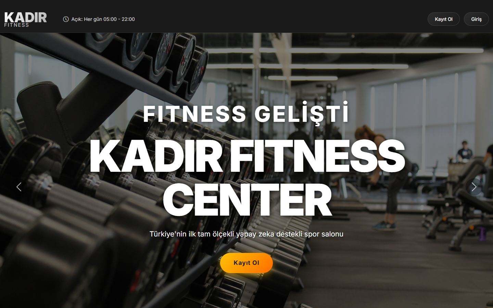
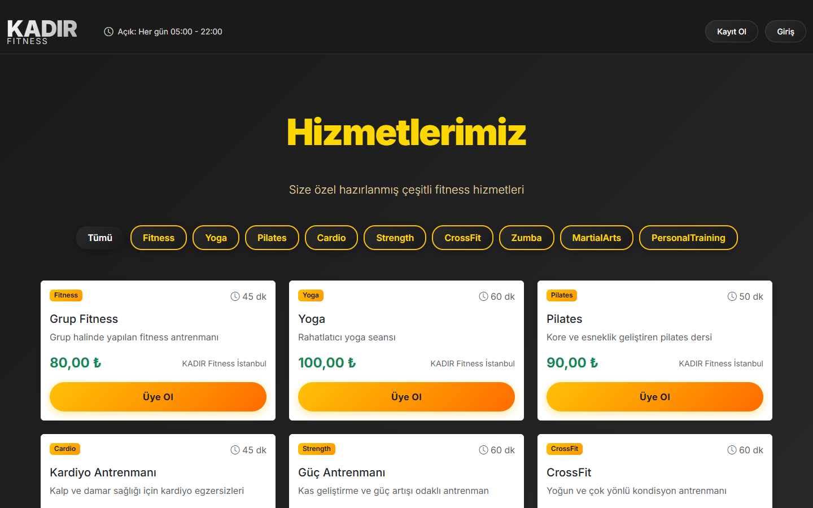
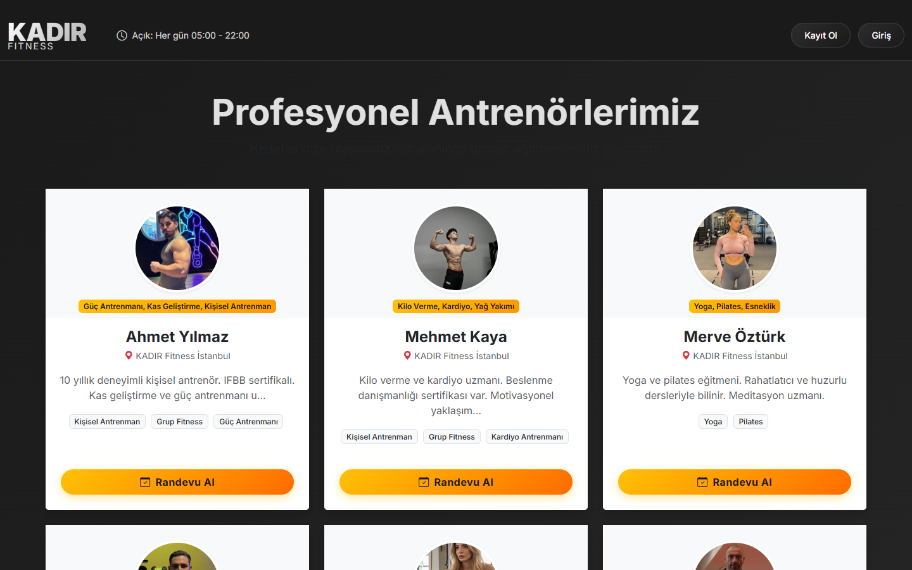
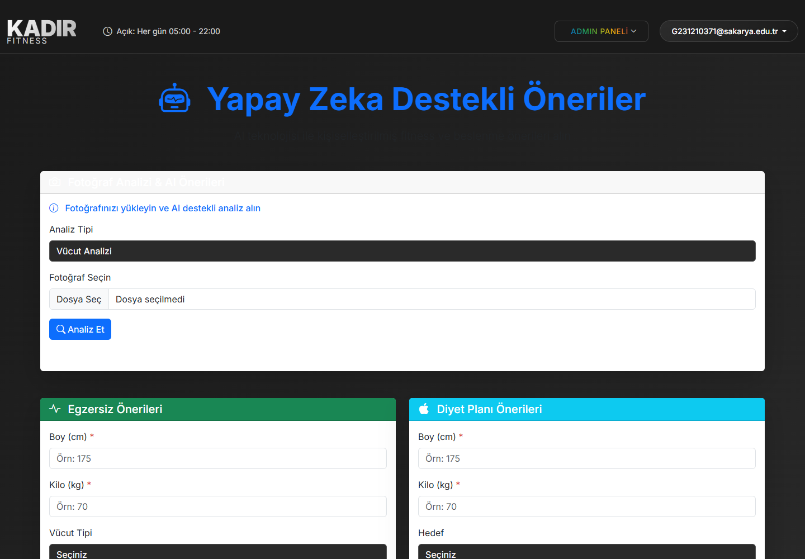
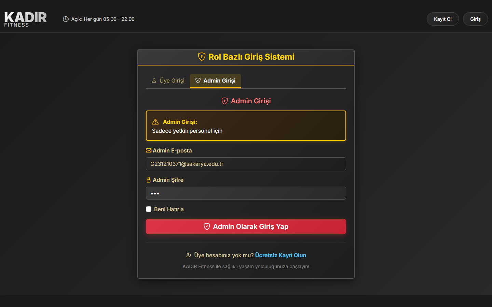
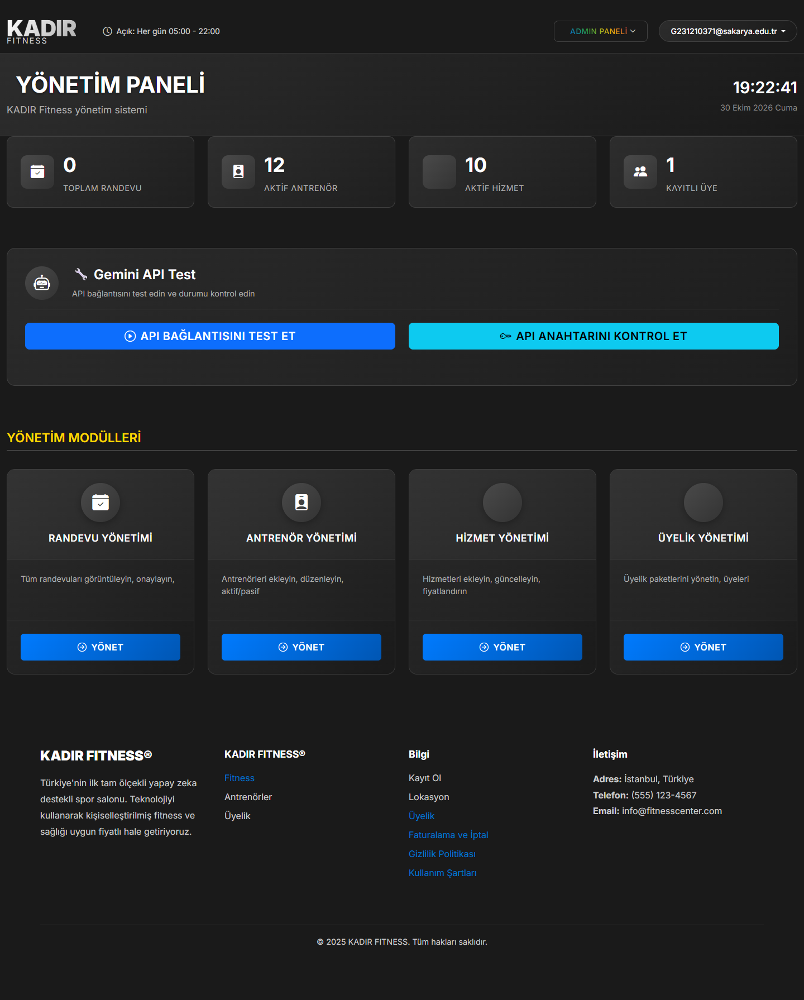
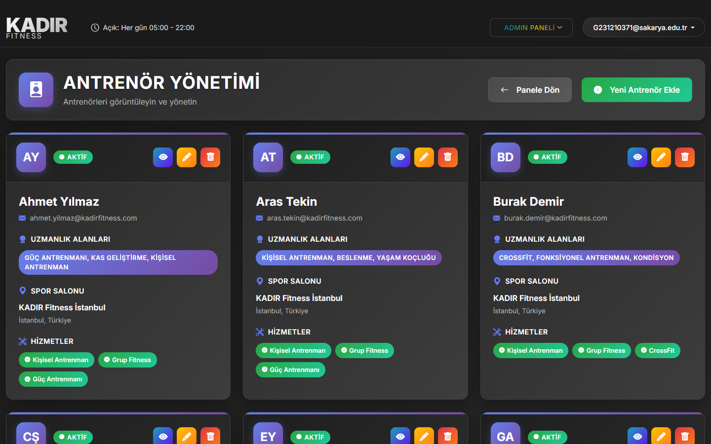
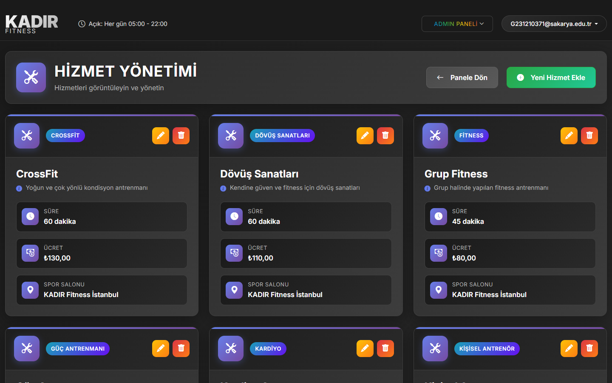
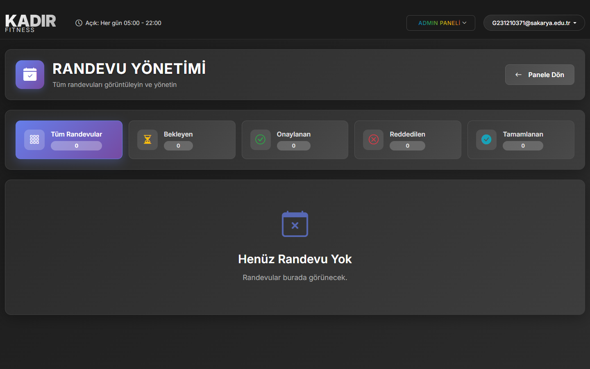
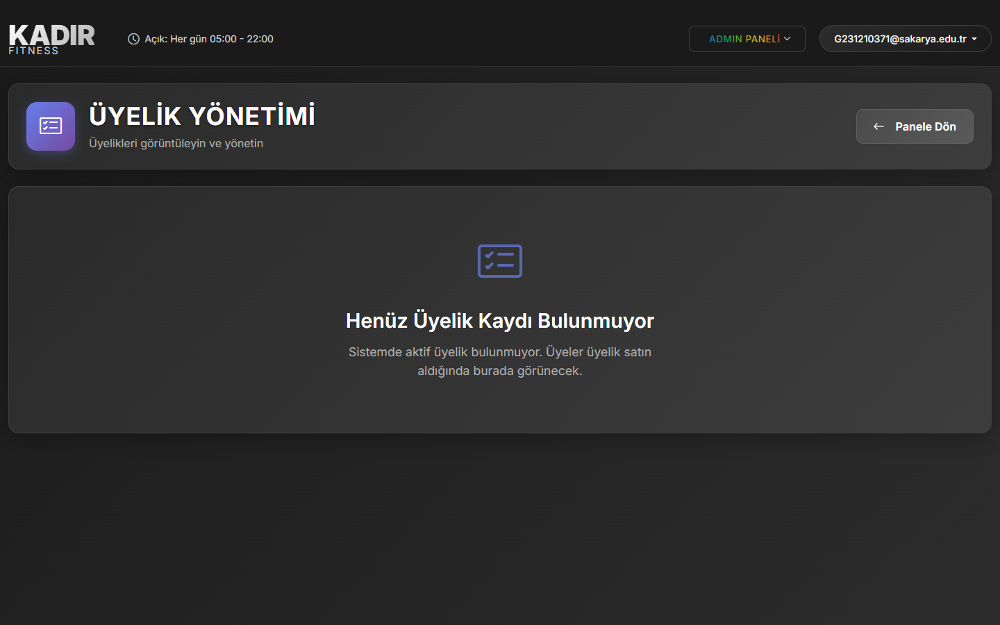

<div align="center">

# FitnessCenter — Yapay Zeka Destekli Spor Salonu Yönetim ve Randevu Platformu

**ASP.NET Core MVC 9.0, Entity Framework Core, RESTful API, Gemini AI ve Docker Destekli Kurumsal Spor Merkezi Otomasyonu**

[](https://dotnet.microsoft.com/)
[](https://learn.microsoft.com/en-us/dotnet/csharp/)
[](https://dotnet.microsoft.com/apps/aspnet)
[](https://learn.microsoft.com/en-us/ef/core/)
[](https://www.docker.com/)
[](https://www.sqlite.org/)
[](https://ai.google.dev/)
[](https://getbootstrap.com/)

</div>

---

## 1. Proje Özeti ve Mimari Yaklaşım

**FitnessCenter**, spor salonlarının hizmet, antrenör (eğitmen), üye ve randevu süreçlerini uçtan uca dijitalleştiren; aynı zamanda üyelerin fiziksel parametrelerine göre **yapay zeka destekli kişiselleştirilmiş antrenman, fotoğraf analizi ve beslenme programları** oluşturan katmanlı bir **ASP.NET Core MVC 9.0** web uygulamasıdır.

Sistem; **ASP.NET Core Identity** tabanlı rol yetkilendirme (`Admin` / `Member`), **Entity Framework Core 9.0** Code-First veritabanı mimarisi, dinamik **LINQ** filtreleme yeteneklerine sahip **RESTful API** uç noktaları ve çok aşamalı (multi-stage) **Docker** mimarisi ile kurumsal standartlarda yapılandırılmıştır.

---

## 2. Ekran Görüntüleri (Arayüz & Admin Paneli)

### 2.1. Kullanıcı Arayüzü
| Ana Sayfa | Hizmetlerimiz |
| :---: | :---: |
|  |  |

| Profesyonel Antrenörlerimiz | Yapay Zeka (AI) Destekli Öneriler |
| :---: | :---: |
|  |  |

### 2.2. Admin Paneli & Yönetim Modülleri
| Rol Bazlı Admin Girişi | Yönetim Paneli (Dashboard) |
| :---: | :---: |
|  |  |

| Antrenör Yönetimi | Hizmet Yönetimi |
| :---: | :---: |
|  |  |

| Randevu Yönetimi | Üyelik Yönetimi |
| :---: | :---: |
|  |  |

---

## 3. Sistem Mimarisi ve Öne Çıkan Özellikler

### 3.1. Temel Modüller
- **Spor Salonu & Hizmet Yönetimi:** Çalışma saatleri, branş/hizmet tanımları (Fitness, Pilates, Yoga, CrossFit, Personal Training vb.), seans süreleri ve dinamik ücretlendirme yönetimi.
- **Antrenör (Trainer) ve Müsaitlik Planlama:** Eğitmen uzmanlık alanları, çalışma takvimleri ve çakışma kontrollü randevu eşleştirme motoru.
- **Randevu ve Onay İş Akışı:** Üyelerin uygun antrenör ve saat dilimlerine randevu oluşturması, arka plan otomatik onay servisi (`AppointmentAutoApprovalService`) ve yönetici onay mekanizması.
- **Yapay Zeka Antrenör & Diyetisyen Modülü (Gemini AI API):** Kullanıcının fotoğrafını, boy, kilo, vücut tipi, hedef ve diyet kısıtlamalarını analiz ederek kişiye özel egzersiz ve beslenme programı üreten servis katmanı.
- **Rol Bazlı Yetkilendirme (RBAC):** `Admin` ve `Member` rolleri için özelleştirilmiş kontrol panelleri ve güvenlik filtreleri.

### 3.2. RESTful API Uç Noktaları (LINQ Filtreleme Destekli)

| HTTP Metodu | Endpoint | Açıklama ve Sorgu Parametreleri |
| :---: | :--- | :--- |
| **`GET`** | `/api/TrainersApi` | Tüm antrenörleri listeler (`fitnessCenterId`, `specialization`, `isActive` filtreleri) |
| **`GET`** | `/api/TrainersApi/{id}` | Belirtilen ID'ye sahip antrenörün detaylı profil ve uzmanlık bilgilerini döner |
| **`GET`** | `/api/TrainersApi/available?date={date}` | Seçilen tarih ve saatte müsait olan antrenörleri LINQ sorgusuyla filtreler |
| **`GET`** | `/api/AppointmentsApi` | Randevuları listeler (`memberId`, `trainerId`, `startDate`, `endDate`, `status`) |
| **`GET`** | `/api/AppointmentsApi/{id}` | Belirli bir randevunun tüm ilişkisel detaylarını JSON formatında döner |

---

## 4. Klasör Mimarisi (Directory Tree)

```text
FitnessCenter/
├── Controllers/                # MVC ve REST API Controller sınıfları (Home, Account, Admin, API)
├── Data/
│   └── ApplicationDbContext.cs # EF Core DbContext, Identity ve ilişkisel tablo yapılandırmaları
├── Filters/                    # Özel yetkilendirme ve doğrulama (Action Filter) sınıfları
├── Migrations/                 # EF Core Code-First veritabanı göç (migration) dosyaları
├── Models/                     # Varlık (Entity) ve ViewModel sınıfları
│   ├── ApplicationUser.cs      # Genişletilmiş ASP.NET Core Identity kullanıcı modeli
│   ├── FitnessCenter.cs        # Spor salonu varlık modeli
│   ├── Trainer.cs              # Antrenör ve uzmanlık alanı modeli
│   ├── Service.cs              # Hizmet, süre ve fiyatlandırma modeli
│   └── Appointment.cs          # Randevu ve onay durumu modeli
├── Services/                   # İş mantığı, GeminiService ve arka plan servisleri
├── Views/                      # Razor View şablonları (Home, Account, Admin, Shared)
├── wwwroot/                    # Statik varlıklar (CSS, JavaScript, Bootstrap 5, Ekran Görüntüleri)
├── Dockerfile                  # Multi-stage .NET 9.0 Docker imaj yapılandırması
├── docker-compose.yml          # Konteyner orkestrasyon ve kalıcı veri (volume) tanımı
├── appsettings.json            # Veritabanı bağlantı dizesi (Connection String) ve API ayarları
├── Program.cs                  # Dependency Injection (DI), Middleware, Seed Data ve Identity yapılandırması
└── FitnessCenter.csproj        # .NET 9.0 proje ve NuGet paket tanımları
```

---

## 5. Kurulum ve Çalıştırma

### 5.1. 🐳 Docker ile Çalıştırma (Önerilen)

Proje çok aşamalı (`multi-stage`) `Dockerfile` ve `docker-compose.yml` ile konteynerize edilmiştir. Herhangi bir harici veritabanı kurulumuna gerek kalmadan SQLite ile anında çalışır:

```bash
# Docker Compose ile derleyip arka planda başlatın
docker compose up -d --build
```
Uygulama **`http://localhost:5253`** adresinde yayına başlar. İlk açılışta veritabanı şeması ve örnek veriler (Admin hesabı, 12 antrenör, 10 hizmet) otomatik olarak oluşturulur.

Tekil Docker komutu ile çalıştırmak isterseniz:
```bash
docker build -t fitnesscenter .
docker run -d -p 5253:8080 --name kadir-fitness-center fitnesscenter
```

### 5.2. 💻 Yerel (.NET 9.0 SDK) ile Çalıştırma

```bash
# 1. Depoyu klonlayın
git clone https://github.com/Kadirduyan/FitnessCenter.git
cd FitnessCenter

# 2. Paketleri yükleyin ve uygulamayı başlatın
dotnet restore
dotnet run --urls "http://localhost:5253"
```

### 5.3. 🔐 Varsayılan Admin Giriş Bilgileri
- **Admin E-posta:** `G231210371@sakarya.edu.tr`
- **Admin Şifre:** `sau`

---

## 6. Geliştirici (Author)

**Kadir Duyan** — *Sakarya Üniversitesi Bilgisayar Mühendisliği*  
- **GitHub:** [github.com/Kadirduyan](https://github.com/Kadirduyan)
- **LinkedIn:** [linkedin.com/in/kadir-duyan4](https://www.linkedin.com/in/kadir-duyan4)
- **E-posta:** [kadirduyan482@gmail.com](mailto:kadirduyan482@gmail.com)
